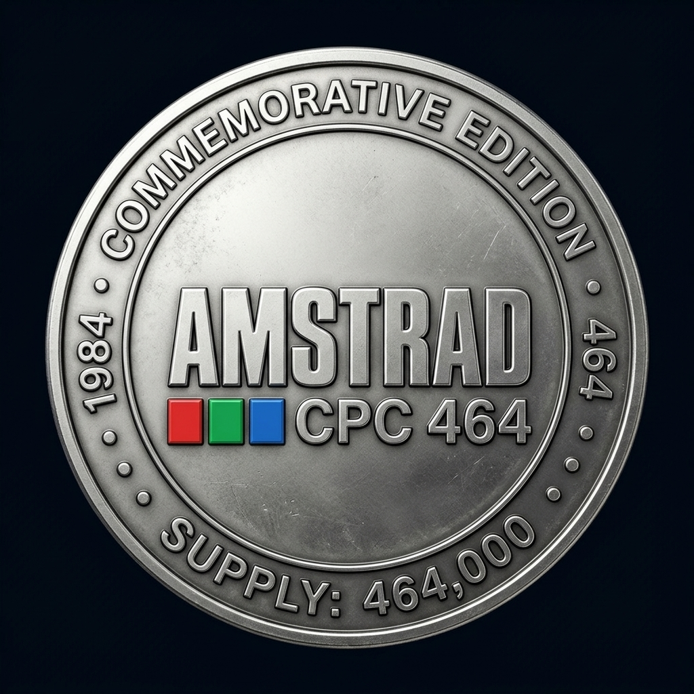

  

# Amstrad CPC 464 Coin (CPC464)

**Commemorative TRC-20 token celebrating the legendary Amstrad CPC 464 home computer (1984).**

## Token Specifications
* **Token Name:** Amstrad CPC 464 Coin
* **Symbol:** CPC464
* **Network:** TRON (TRC-20)
* **Decimals:** 6
* **Total Supply:** 464,000 CPC464 (Fixed Edition)

## About the Project
Created as a tribute to the iconic 8-bit microcomputers of the 1980s and the retro computing community.
